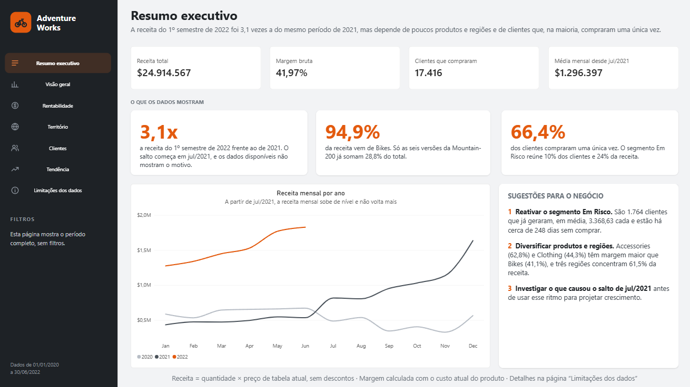
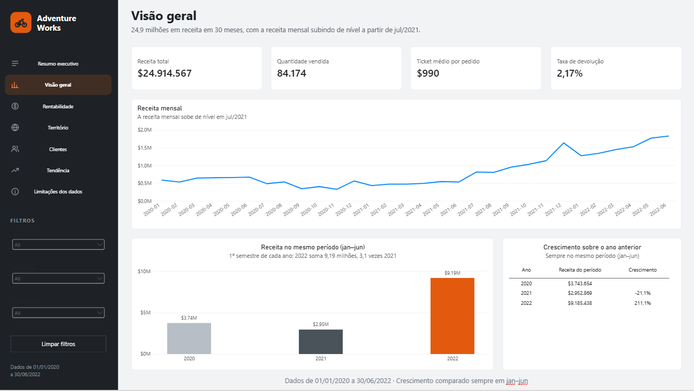
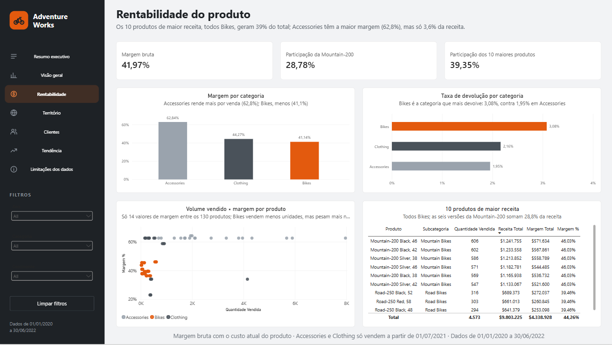
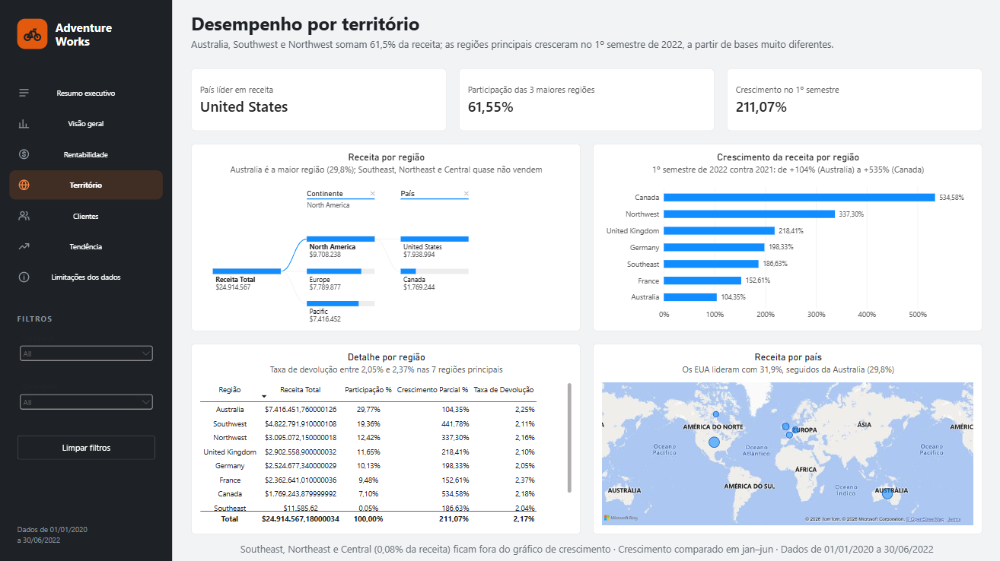
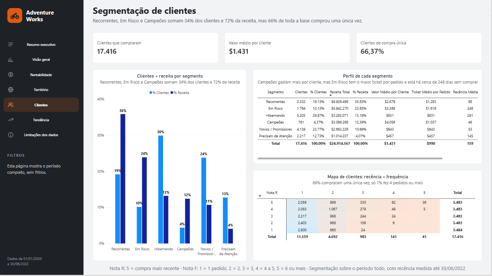
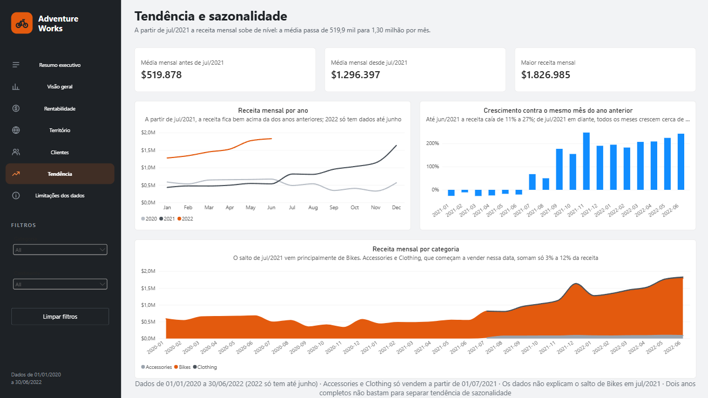
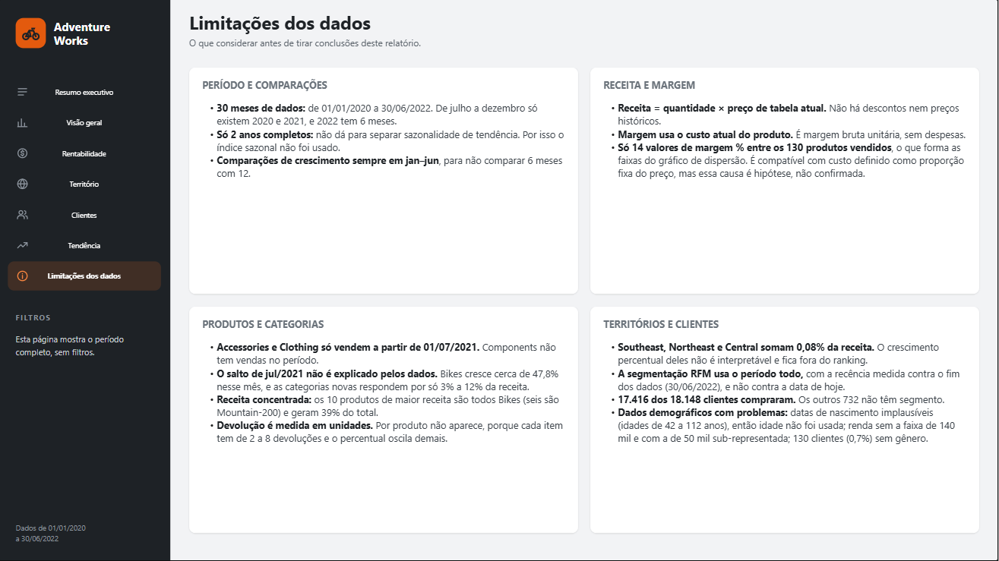
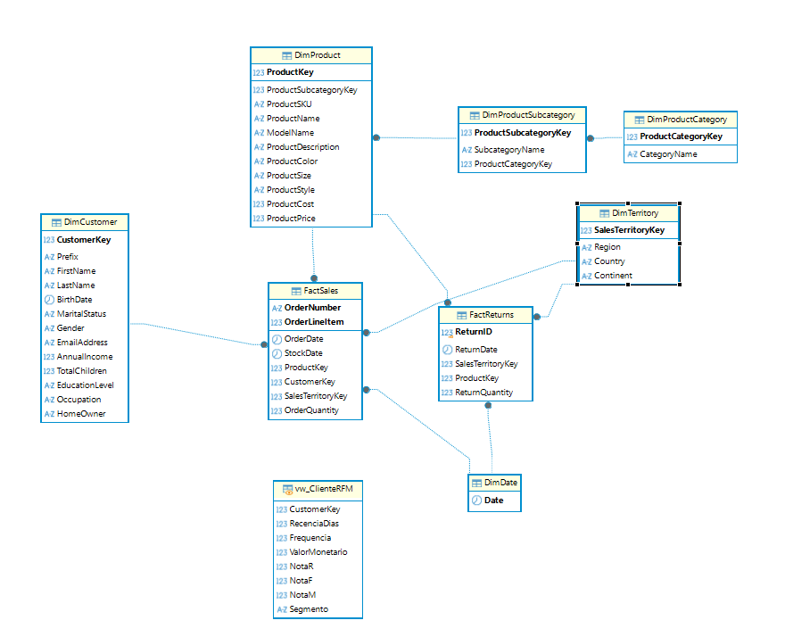

# AdventureWorks — Vendas, Rentabilidade e Clientes (SQL Server + Power BI)

Projeto de análise de dados de ponta a ponta com o dataset público **AdventureWorks** (versão Maven Analytics): da carga dos CSVs brutos num modelo estrela em **SQL Server**, passando por diagnóstico, limpeza e validação dos dados, até um **dashboard de 5 páginas no Power BI** com resumo executivo.

> **Moeda:** os valores são apresentados em dólares americanos (US$), convenção do AdventureWorks. O dataset não informa a moeda de forma explícita.

**Demonstração em vídeo (1 a 2 min):** [assistir no YouTube](https://youtu.be/S4QGLxKrsxc)



---

## Principais achados

| # | Achado | Números |
|---|---|---|
| 1 | **A receita mudou de patamar em jul/2021.** Até jun/2021 cada mês caía de 11% a 27% contra o mesmo mês do ano anterior; depois disso todos os meses crescem de cerca de 50% a 247%. O salto vem principalmente de Bikes, e os dados não explicam a causa | 1º semestre de 2022: US$ 9,19 mi contra US$ 2,95 mi em 2021 (3,1×). Média mensal: US$ 519.878 → US$ 1.296.397 (2,5×) |
| 2 | **A receita é muito concentrada** em poucos produtos e territórios | Bikes = 94,9% da receita. Seis variações da Mountain-200 = 28,8%. Os 10 maiores produtos = 39,4%. Australia, Southwest e Northwest = 61,5% |
| 3 | **A base de clientes compra pouco** | 66% compraram uma única vez. Campeões, Recorrentes e Em Risco = 34% dos clientes e 72% da receita. Em Risco: 1.764 clientes, 23,9% da receita, ~248 dias sem comprar |

Outros números de referência: receita total de **US$ 24.914.567,18** (jan/2020 a jun/2022), 84.174 unidades vendidas, 17.416 clientes que compraram, margem bruta de **41,97%** e taxa de devolução de **2,17%** (Bikes 3,08%, Clothing 2,16%, Accessories 1,95%).

### Recomendações
1. **Reativar o segmento Em Risco**: clientes de alto valor (US$ 3.368,63 por cliente) que pararam de comprar.
2. **Reduzir a dependência** de poucos produtos e territórios, avaliando o potencial de Accessories e Clothing, que têm margem unitária maior (cerca de 62% contra 40% a 46% em Bikes).
3. **Entender o salto de jul/2021 antes de projetar crescimento**: confirmar com o negócio se houve mudança de preço, lançamento ou de registro dos dados.

---

## Perguntas de negócio

| Página do dashboard | Pergunta |
|---|---|
| Resumo Executivo | O que o negócio precisa saber e fazer? |
| 1. Visão Geral | Como está o negócio, de forma resumida? |
| 2. Rentabilidade de Produto | O que vende mais e o que rende mais, e eles são os mesmos? |
| 3. Performance por Território | Onde o negócio cresce ou estagna? |
| 4. Comportamento do Cliente (RFM) | Quem são os melhores clientes e quem está em risco? |
| 5. Tendência e Sazonalidade | Quando o negócio vende mais, e esse padrão se repete? |

Há ainda uma página oculta, **Limitações do data set**, com o que os dados permitem e não permitem concluir.

---

## Dashboard

| | |
|---|---|
|  |  |
|  |  |
|  |  |

O arquivo `.pbix` está em [`powerbi/`](powerbi/). O modelo usa o modo Importar, relacionamentos de dimensão para fato em um sentido, a `DimDate` marcada como tabela de datas e uma tabela `Medidas` com todas as medidas DAX.

---

## Stack

- **SQL Server** — modelagem, constraints, carga, diagnóstico, limpeza e análises (T-SQL: CTEs, funções de janela, `PERCENTILE_CONT`, `NTILE`).
- **DBeaver** — cliente SQL, importação dos CSVs e diagrama ER.
- **Power BI** — modelo, medidas DAX e dashboard.

---

## Modelo de dados

Modelo **estrela**: seis dimensões e duas tabelas de fato.



| Tabela | Tipo | Chave |
|---|---|---|
| `DimDate` | Dimensão | `Date` |
| `DimTerritory` | Dimensão | `SalesTerritoryKey` |
| `DimProductCategory` | Dimensão | `ProductCategoryKey` |
| `DimProductSubcategory` | Dimensão | `ProductSubcategoryKey` |
| `DimProduct` | Dimensão | `ProductKey` |
| `DimCustomer` | Dimensão | `CustomerKey` |
| `FactSales` | Fato | (`OrderNumber`, `OrderLineItem`) |
| `FactReturns` | Fato | `ReturnID` (substituta) |

Para o Power BI, a segmentação RFM é exposta pela view `vw_ClienteRFM`, uma linha por cliente que comprou, ligada à `DimCustomer` em relação um para um.

---

## Estrutura do repositório

```
.
├── README.md
├── sql/
│   ├── 01_schema/          # criação das tabelas e constraints
│   ├── 02_profiling/       # diagnóstico de cada tabela
│   ├── 03_cleaning/        # decisões de tratamento
│   ├── 04_validation/      # integridade referencial e volumetria
│   └── 05_analysis/        # uma análise por página do dashboard
├── powerbi/                # arquivo .pbix
└── docs/
    ├── er-diagram.png
    ├── img/                # prints do dashboard
    └── *.md                # documentação detalhada do processo
```

---

## Como reproduzir

1. Crie o banco `AdventureWorksAnalysis` no SQL Server, separado dos bancos de sistema.
2. Execute os scripts de `01_schema`, que criam as dimensões antes das tabelas de fato.
3. Importe os 10 CSVs (DBeaver, assistente "Import Data") respeitando a ordem: dimensões primeiro, fatos por último. Mapeie `TerritoryKey` para `SalesTerritoryKey` e desative o *batch insert* para que um erro de linha apareça em vez de falhar em silêncio. Remova a linha de rodapé do CSV de clientes antes de importar.
4. Execute `03_cleaning` e depois `04_validation` (órfãos de FK e volumetria devem estar zerados e coerentes).
5. Execute os scripts de `05_analysis`. O de clientes cria a view `vw_ClienteRFM`.
6. Abra o `.pbix` e aponte a fonte de dados para o seu servidor.

---

## Cuidados metodológicos

- **Comparações no mesmo período.** Os dados terminam em 30/06/2022, então o crescimento é sempre comparado em jan–jun entre os anos.
- **Sem efeito *fan-out*.** Vendas e devoluções são agregadas separadamente antes de se juntarem; a primeira versão da taxa de devolução por produto passou de 100% por esse erro, e foi corrigida.
- **Segmentação RFM reproduzível.** O `NTILE` usa `CustomerKey` como desempate; sem isso, clientes com a mesma recência ou o mesmo valor caíam em faixas diferentes a cada execução.
- **Territórios sem relevância.** Southeast, Northeast e Central somam 0,08% da receita, então ficam fora do ranking de crescimento.
- **Validação cruzada.** Cada número do Power BI foi conferido contra a consulta SQL equivalente.

## Limitações

Resumo; a lista completa está na página oculta do dashboard e em [`docs/05_limitacoes.md`](docs/05_limitacoes.md).

- Dados de 01/01/2020 a 30/06/2022; só dois anos completos, o que impede separar sazonalidade de tendência.
- Receita = quantidade × preço de tabela atual (sem descontos); margem usa o custo atual do produto.
- Só 14 valores de margem % entre os 130 produtos vendidos.
- Accessories e Clothing só vendem a partir de 01/07/2021; Components não tem vendas.
- O salto de jul/2021 não é explicado pelos dados.
- Datas de nascimento implausíveis; idade não foi usada nas análises.

---

## Documentação detalhada

O processo completo, em ordem:

1. [Modelo de dados e carga](docs/01_modelo_e_carga.md) — fonte, modelo estrela e os problemas encontrados na importação
2. [Diagnóstico e tratamento](docs/02_diagnostico_e_tratamento.md) — profiling de cada tabela, decisões de limpeza e validações de integridade
3. [Análises em SQL](docs/03_analises_sql.md) — resultados por página e correções de método
4. [Power BI](docs/04_powerbi.md) — modelo, medidas DAX, validação e páginas do dashboard
5. [Limitações do data set](docs/05_limitacoes.md)
