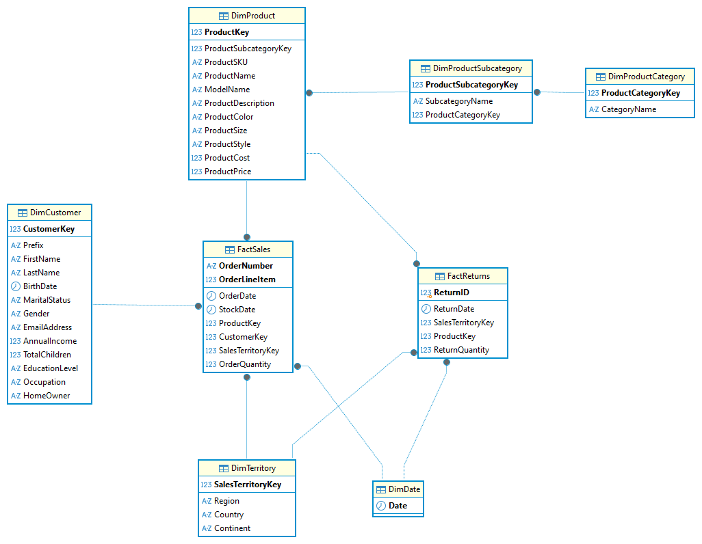

# 1. Modelo de dados e carga

[← Voltar ao README](../README.md)

Este documento descreve a fonte dos dados, o modelo estrela, o ambiente e os problemas encontrados durante a carga, com as decisões tomadas em cada um. Registrar esses pontos mostra o processo de diagnóstico, não só o resultado final.

## Fonte de dados

O dataset é composto por 10 arquivos CSV e pode ser encontrado em https://www.kaggle.com/datasets/shaikhshoeb/adventureworks-dataset-for-data-analysis:

| Arquivo | Conteúdo |
|---|---|
| AdventureWorks Calendar Lookup | Calendário (datas) |
| AdventureWorks Customer Lookup | Clientes |
| AdventureWorks Product Categories Lookup | Categorias de produto |
| AdventureWorks Product Subcategories Lookup | Subcategorias de produto |
| AdventureWorks Product Lookup | Produtos |
| AdventureWorks Territory Lookup | Territórios de venda |
| AdventureWorks Sales Data 2020 / 2021 / 2022 | Vendas (3 arquivos, mesma estrutura) |
| AdventureWorks Returns Data | Devoluções |

## Modelo estrela

Tabelas de **dimensão** descrevem "quem, o quê, onde, quando"; tabelas de **fato** registram eventos mensuráveis (vendas e devoluções).

**Dimensões**
- `DimDate` — PK: `Date`
- `DimTerritory` — PK: `SalesTerritoryKey`
- `DimProductCategory` — PK: `ProductCategoryKey`
- `DimProductSubcategory` — PK: `ProductSubcategoryKey` · FK: `ProductCategoryKey` → `DimProductCategory`
- `DimProduct` — PK: `ProductKey` · FK: `ProductSubcategoryKey` → `DimProductSubcategory`
- `DimCustomer` — PK: `CustomerKey`

**Fatos**
- `FactSales` — PK composta (`OrderNumber`, `OrderLineItem`) · FKs: `ProductKey`, `CustomerKey`, `SalesTerritoryKey`, `OrderDate`. Consolida os 3 arquivos de vendas (2020/2021/2022) em uma única tabela.
- `FactReturns` — PK substituta (`ReturnID`, `IDENTITY`) · FKs: `ProductKey`, `SalesTerritoryKey`, `ReturnDate`.

**Ordem de criação e carga:** dimensões primeiro (respeitando a hierarquia Categoria → Subcategoria → Produto) e fatos por último, exigência do SQL Server para as constraints de chave estrangeira.

## Ambiente

- **Banco:** `AdventureWorksAnalysis` (SQL Server), isolado dos bancos de sistema (`master`, `model`, `msdb`, `tempdb`).
- **Gerenciamento:** DBeaver, conectado via TCP/IP ao SQL Server local.
- **Carga:** assistente "Import Data" do DBeaver, a partir dos CSVs.

## Problemas encontrados na carga

### 1. Nome de coluna divergente entre origem e destino
Os arquivos de vendas e devoluções trazem a coluna `TerritoryKey`, enquanto o modelo usa `SalesTerritoryKey` (nome padronizado com a dimensão).
**Decisão:** padronizar o nome no modelo e corrigir o mapeamento manualmente em cada importação.

### 2. Falha silenciosa em importação por lote (*batch insert*)
Importações grandes (`FactSales`, `DimCustomer`) falharam sem preencher a tabela e sem mensagem clara: o modo *batch insert* do DBeaver rejeitava o lote inteiro ao encontrar uma linha problemática.
**Decisão:** desabilitar o *batch insert* (inserção linha a linha) nas cargas problemáticas, para expor o erro real por linha.

### 3. Violação de chave estrangeira (`FactSales` → `DimCustomer`)
A importação da `FactSales` falhava por `CustomerKey` inexistente na dimensão de clientes.
**Diagnóstico:** criada uma tabela de *staging* (`DimCustomer_Staging`, sem constraints) para importar os dados brutos e investigar via SQL sem risco de a importação travar.
**Causa raiz:** a `DimCustomer` estava incompleta (24 de cerca de 18.000 linhas esperadas), pela mesma falha silenciosa do item 2.

### 4. Truncamento de dado (`Gender`)
Erro de truncamento ao importar `DimCustomer`: a coluna `Gender`, definida como `CHAR(1)`, não comportava um valor de exceção presente no arquivo.
**Decisão:** ampliar a coluna para `VARCHAR(10)`, para capturar o valor real antes de decidir como tratá-lo.

### 5. Linha de rodapé no CSV
O arquivo de clientes continha uma linha de metadado no final (carimbo de exportação, "Export date…") que não é um cliente e quebrava a leitura das colunas numéricas.
**Decisão:** remover a linha em editor de texto simples e salvar uma cópia limpa, mantendo o original como backup. Evitado o Excel nessa edição, pelo risco de reformatar datas, perder zeros à esquerda e alterar a codificação.

### 6. Duplicidade de registros em `DimCustomer`
Após os ajustes anteriores, 18.149 `CustomerKey` apareciam duplicados (quase a tabela inteira).
**Diagnóstico:** a contagem total mostrou que o CSV havia sido importado duas vezes na staging, por reprocessamento durante as tentativas anteriores; não era duplicidade do dado de origem.
**Decisão:** truncar a staging e reimportar uma única vez; carga final feita com `INSERT INTO … SELECT` da staging validada para a tabela oficial.

As tabelas de staging (`DimCustomer_Staging`, `FactSales_Staging`) serviram só para diagnóstico e foram removidas do modelo final.

---

Próximo: [2. Diagnóstico e tratamento →](02_diagnostico_e_tratamento.md)
